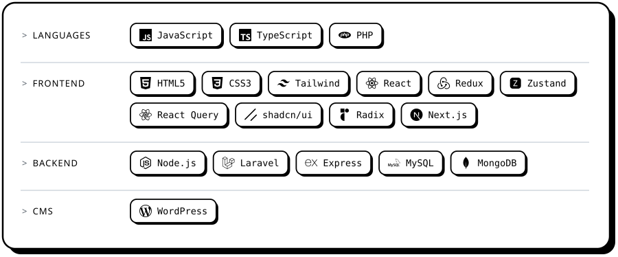

  <a href="https://jefferson-panchi.vercel.app/">
    <picture>
      <source media="(prefers-color-scheme: dark)" srcset="assets/header-dark.svg">
      
    </picture>
  </a>
    
  

 

<h3>
  <picture>
    <source media="(prefers-color-scheme: dark)" srcset="assets/title-about-dark.svg">
    
  </picture>
</h3>

Software Engineer with progressive knowledge in web systems development and management, with great enthusiasm for venturing into **cybersecurity**. I describe myself as creative and inventive, with an established focus on creating **secure and reliable user experiences**. I enjoy volunteering, motivated by the opportunity to support and serve others.

<h3>
  <picture>
    <source media="(prefers-color-scheme: dark)" srcset="assets/title-toolbox-dark.svg">
    
  </picture>
</h3>

<picture>
  <source media="(prefers-color-scheme: dark)" srcset="assets/toolbox-dark.svg">
  
</picture>

<h3>
  <picture>
    <source media="(prefers-color-scheme: dark)" srcset="assets/title-learning-dark.svg">
    
  </picture>
</h3>

<picture>
  <source media="(prefers-color-scheme: dark)" srcset="assets/learning-dark.svg">
  
</picture>

<h3>
  <picture>
    <source media="(prefers-color-scheme: dark)" srcset="assets/title-stats-dark.svg">
    
  </picture>
</h3>

  <picture>
    <source media="(prefers-color-scheme: dark)" srcset="https://streak-stats.demolab.com?user=jfpanchi&theme=dark&background=000000&border=FFFFFF&stroke=FFFFFF&ring=FFFFFF&fire=FFFFFF&currStreakNum=FFFFFF&sideNums=FFFFFF&currStreakLabel=FFFFFF&sideLabels=FFFFFF&dates=9198A1&border_radius=16">
    
  </picture>

<h3>
  <picture>
    <source media="(prefers-color-scheme: dark)" srcset="assets/title-connect-dark.svg">
    
  </picture>
</h3>

  <a href="https://jefferson-panchi.vercel.app/">
    <picture>
      <source media="(prefers-color-scheme: dark)" srcset="assets/portfolio-dark.svg">
      
    </picture>
  </a>

